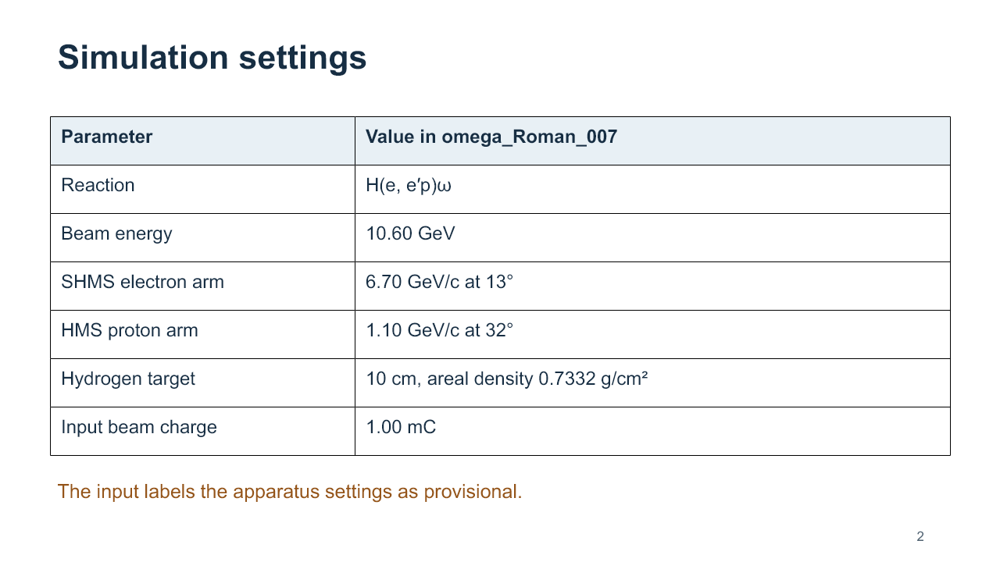
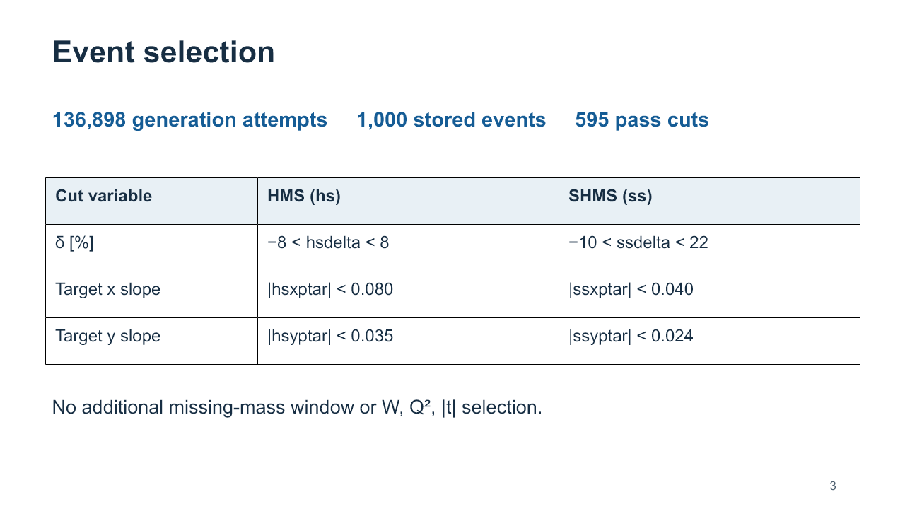
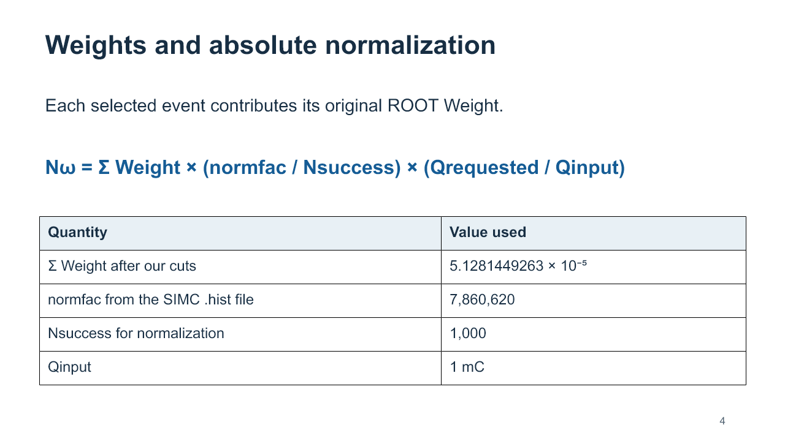
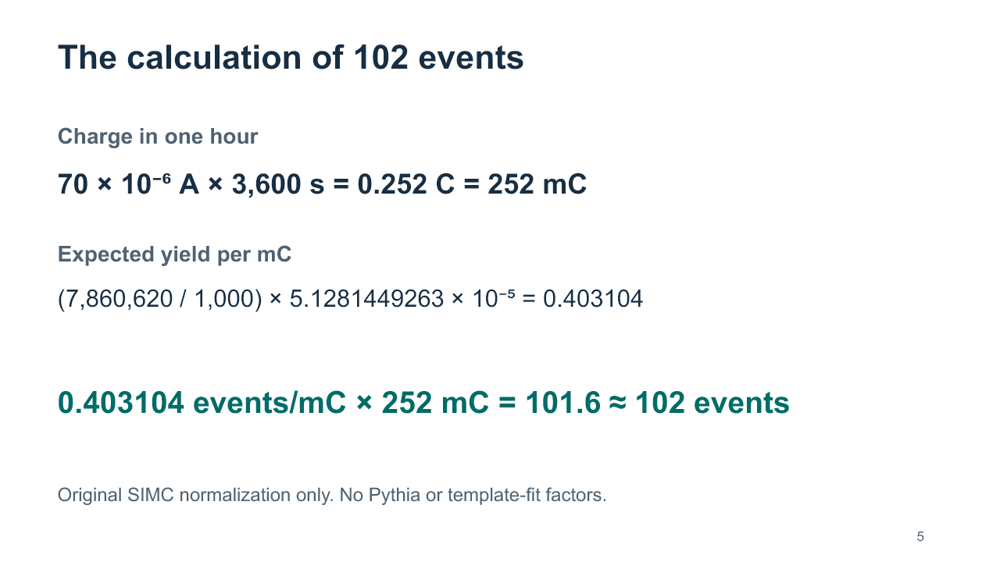
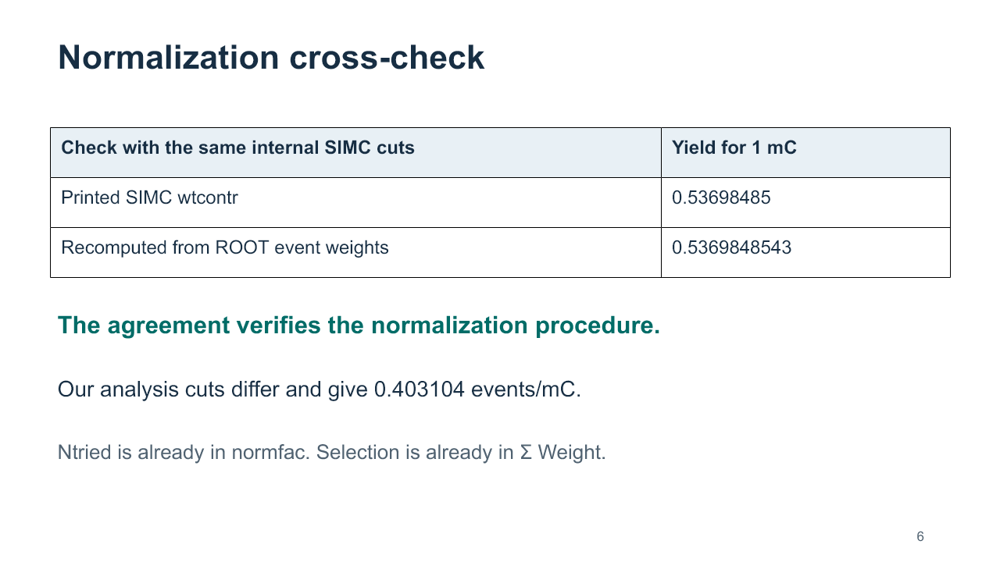
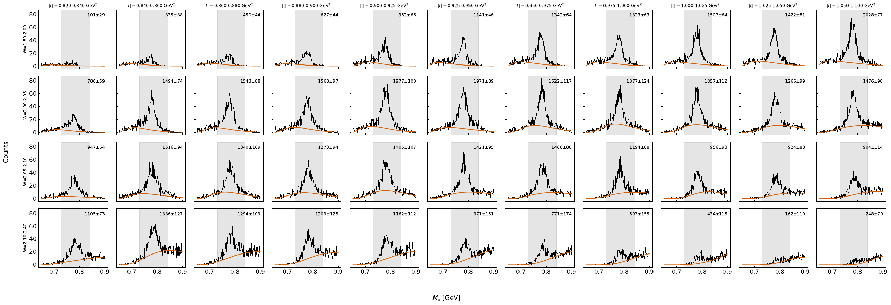
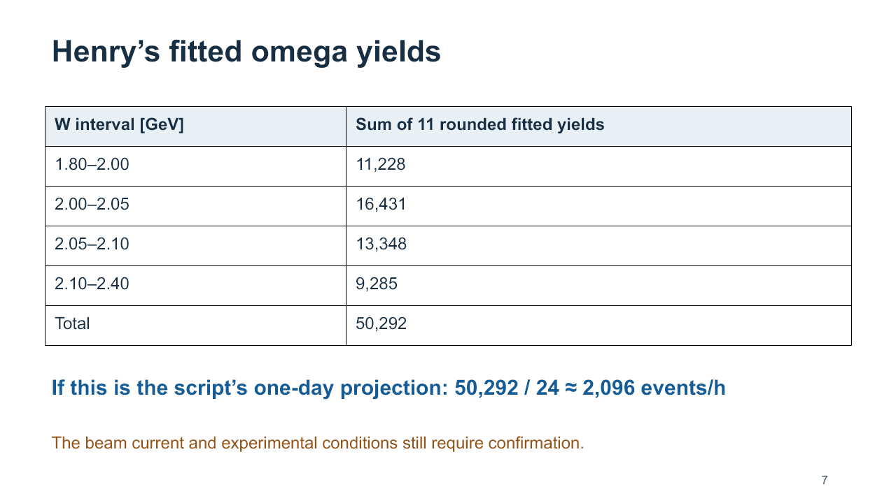
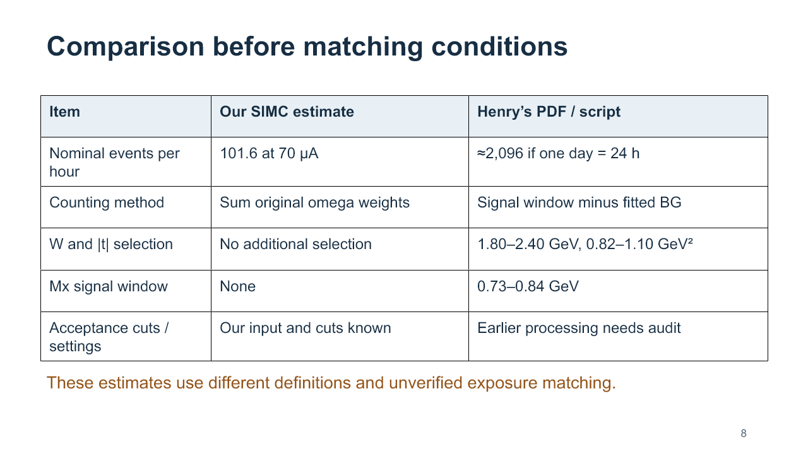
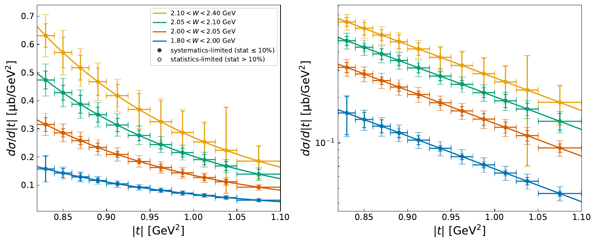

# Omega yield estimate: SIMC calculation and comparison with Henry

# Оцінка виходу omega: розрахунок SIMC і порівняння з Генрі

Матеріал для доповіді в Notion. English — текст, який можна говорити на зустрічі. Українська — переклад і пояснення. Зображення з таблицями — ілюстрації з нашої презентації, а не прямі скриншоти ROOT. Графіки Генрі — з його оригінальних PDF.

**Main result / Головний результат:** Our existing SIMC omega run predicts approximately **102 events in one hour at 70 μA**, after the specified analysis cuts, within the generated phase space. Additional detector efficiencies and DAQ live time are not included. / Наш наявний omega-запуск SIMC дає прогноз **приблизно 102 події за годину при 70 μA** після заданих cuts у межах згенерованого фазового простору. Додаткові ефективності детекторів і live time не враховано.

## 1. Purpose of the calculation / Мета розрахунку

### English — what to say

Bill asked how many omega events we could expect in one hour with a 70-microamp beam. I used the existing omega simulation, applied our analysis cuts, and converted the selected event weights into an expected yield using the normalization from that same SIMC run.

The result is approximately 102 events per hour. This is a simulation-based prediction, not an experimental measurement. It does not use the scale factors from our seven-channel fit to Pythia.

### Українською

Біл попросив оцінити, скільки omega-подій можна очікувати за годину при струмі 70 мікроамперів. Я використав уже виконаний omega-запуск, застосував наші cuts і перевів суму відібраних ваг в очікуваний вихід за допомогою нормалізації цього самого запуску SIMC.

Отримано приблизно 102 події за годину. Це прогноз із симуляції, а не вимірювання. Коефіцієнти нашого семиканального фіту до Pythia в цей розрахунок не входять.

**Пояснення:** «Модельне» та «з нашого запуску» не суперечать одне одному. Ми взяли реальні результати виконаної симуляції, але вона описує фізику за певною моделлю. 102 — не кількість записів у ROOT-файлі.

## 2. Simulation settings / Налаштування запуску



*EN: Settings of our omega_Roman_007 run. UA: Налаштування саме нашого запуску omega_Roman_007.*

### English — what to say

The simulated reaction is H(e, e′p)ω. The beam energy is 10.60 GeV. The SHMS detects the scattered electron with a central momentum of 6.70 GeV/c at 13 degrees. The HMS detects the proton with a central momentum of 1.10 GeV/c at 32 degrees.

The input describes a 10-centimetre hydrogen target with an areal density of 0.7332 grams per square centimetre. The reference charge for the simulation normalization is 1 millicoulomb. These values come directly from our input file and the SIMC output report. The input labels the apparatus configuration as provisional, so we still need to confirm that it matches Henry’s actual production setup.

### Українською

Реакція — H(e, e′p)ω, енергія пучка — 10,60 GeV. SHMS реєструє розсіяний електрон: центральний імпульс 6,70 GeV/c, кут 13°. HMS реєструє протон: 1,10 GeV/c, кут 32°.

У налаштуваннях використано водневу мішень довжиною 10 cm із поверхневою густиною 0,7332 g/cm². Опорний заряд для нормалізації становить 1 mC. Ці значення взяті з input-файлу і звіту виконаного запуску. Налаштування позначені як provisional: їхню відповідність фактичному запуску Генрі ще треба підтвердити.

**Де перевірити:** `omega_Roman_007.inp`: рядок 5 — заряд; 11–12 — реакція; 17–24 — пучок і спектрометри; 28–33 — мішень. У `omega_Roman_007.hist`, рядок 41, прямо надруковано `length = 0.100000E+02 cm`, тобто 10 cm.

**Пояснення:** Центральні імпульси та кути задають налаштування спектрометрів. Події всередині їхнього acceptance мають розподіли імпульсів і кутів, а не лише ці центральні значення. Заряд 1 mC — опорна нормалізація, не означає, що симуляцію фізично запускали з реальним пучком.

## 3. Event selection / Відбір подій



*EN: Simulation counters and additional analysis cuts. UA: Лічильники симуляції та додаткові analysis cuts.*

### English — what to say

SIMC made 136,898 generation attempts to obtain the requested 1,000 successful events. We then applied the same HMS and SHMS analysis cuts that we had used in the earlier plots. Of the 1,000 stored events, 595 passed all these cuts.

For this rate calculation, we did not add a separate missing-mass window or additional W, Q-squared, or momentum-transfer cuts. This does not mean the simulation covers all possible kinematics: the generator and spectrometer transport already limit the sample.

### Українською

SIMC зробив 136 898 спроб генерації, щоб отримати задані 1 000 успішних подій. Після цього ми застосували ті самі HMS/SHMS cuts, які використовували для попередніх графіків. Усі умови одночасно пройшли 595 подій.

У цьому розрахунку немає додаткового вікна missing mass чи додаткових cuts за W, Q² і переданим імпульсом. Але сама генерація й транспорт через спектрометри вже обмежують кінематичну область.

**Точні cuts:**

```cpp
abs(hsdelta) < 8.0
&& abs(hsxptar) < 0.080
&& abs(hsyptar) < 0.035
&& ssdelta > -10.0 && ssdelta < 22.0
&& abs(ssxptar) < 0.040
&& abs(ssyptar) < 0.024
```

**Пояснення:** `hs` відповідає HMS, `ss` — SHMS. `delta` — відхилення імпульсу від центрального значення у відсотках. `xptar` і `yptar` — нахили траєкторії в координатах спектрометра біля мішені. Ці cuts надійшли в початковому запиті на аналіз; ми не підбирали їх, щоб отримати 102.

**Джерело чисел:** `.hist`, рядки 76–78: `Ngen=1000`, `Ntried=136898`, `Ncontribute=1000`. Число 595 отримано перевіркою записів ROOT-дерева `h10`; воно збережене у звіті аудиту як `after_cuts`.

## 4. Event weights and normalization / Ваги й нормалізація



### English — what to say

The number 595 is the number of selected Monte Carlo events. To predict an experimental yield, we must account for their weights and the normalization of the simulation.

I used the original Weight branch from the omega ROOT file. The sum of weights after cuts is 5.1281449263 times ten to the minus five. The SIMC report gives normfac equal to 7,860,620. For this run, the normalization denominator is the 1,000 successful events, before our additional analysis cuts.

I multiplied the selected weight sum by normfac divided by 1,000, and then scaled the result from the input charge to the requested charge.

### Українською

595 — це число відібраних Monte Carlo-подій. Для прогнозу фізичного виходу потрібно врахувати їхні ваги й нормалізацію симуляції.

Використано оригінальну гілку `Weight` omega ROOT-файлу. Сума ваг після cuts дорівнює 5,1281449263 × 10⁻⁵. Звіт SIMC дає `normfac = 7 860 620`. У знаменнику використовуємо 1 000 успішних подій до додаткових cuts.

Суму відібраних ваг множимо на `normfac / 1000`, а потім масштабуємо до потрібного заряду.

```text
N_expected = sum(Weight after cuts)
             × normfac / Nsuccess
             × requested_charge / input_charge
```

**Пояснення:** `Weight` уже міститься в результаті генератора та залежить від його фізичної моделі. Це не вручну підібраний коефіцієнт кривої. `normfac` додає нормалізацію на світність і обсяг генерації та враховує кількість спроб. Не треба додатково ділити на 136 898 або множити на 595/1000: це повторно врахувало б те, що вже входить у розрахунок.

**Джерела:** `.hist`, рядок 97 — `normfac`; `omega_rate_audit_70uA_1h/summary.json` — сума ваг та знаменник. У зафіксованому коді SIMC `event.f` формує вагу, а `results_write.f` записує її в ntuple.

## 5. Calculation of 102 events / Як отримано 102



### English — what to say

A 70-microamp beam delivers 0.252 coulombs in one hour, which is 252 millicoulombs. Our normalized omega yield after cuts is 0.403104 events per millicoulomb. Multiplying by 252 gives 101.58 expected events, which we round to approximately 102.

The calculation uses the original SIMC normalization. It does not use the omega-peak matching or the free scale factors from the Pythia template fit.

### Українською

За годину пучок зі струмом 70 μA дає заряд 0,252 C, або 252 mC. Нормалізований вихід omega після cuts становить 0,403104 події на mC. Множимо на 252 і отримуємо 101,58 події, тобто приблизно 102.

Тут використана початкова нормалізація SIMC. Нормування піку omega до Pythia та вільні коефіцієнти template fit сюди не входять.

```text
Q = 70 × 10^-6 A × 3600 s = 0.252 C = 252 mC

Yield at 1 mC = (7,860,620 / 1,000) × 5.1281449263 × 10^-5
             = 0.4031039857 events

Yield at 252 mC = 0.4031039857 × 252
               = 101.5822 ≈ 102 events
```

**Пояснення:** Не можна сказати «ми згенерували 102 події». Згенеровано і збережено 1 000 подій. Їхні ваги дозволили оцінити очікувану кількість для заданого пучка й часу.

## 6. Check of the normalization / Перевірка нормалізації



### English — what to say

As a consistency check, we reconstructed the integrated yield printed in the SIMC report. Using the same internal cuts as the original code, the ROOT-weight calculation gives 0.5369848543 events for 1 millicoulomb. The report prints 0.53698485, so the values agree within rounding.

These internal cuts differ from our analysis cuts, which give 0.403104 events per millicoulomb. This check supports the arithmetic of the normalization, but it does not independently validate the omega cross-section model.

### Українською

Для перевірки ми відтворили інтегральний вихід, надрукований у звіті SIMC. З тими самими внутрішніми cuts оригінального коду розрахунок із ROOT-ваг дає 0,5369848543 події для 1 mC. У звіті надруковано 0,53698485, тобто значення збігаються в межах округлення.

Внутрішні cuts відрізняються від наших analysis cuts, які дають 0,403104 події на mC. Ця перевірка підтверджує узгодженість арифметики, але не доводить фізичну правильність моделі перерізу omega.

**Пояснення:** Числа 0,53698 і 0,40310 не суперечать одне одному: відрізняється відбір. Для прогнозу 102 використано друге число, відповідне нашим cuts.

## 7. Henry’s omega yields / Виходи omega у Генрі



*EN: Original figure from omega_mx_grid_1over35.pdf. UA: Оригінальна сітка графіків Генрі; відкрий зображення окремо для читання дрібних підписів.*

### English — what to say

Henry’s figure contains 44 missing-mass spectra, arranged in four W intervals and eleven momentum-transfer intervals. In the supplied script, the omega yield is the number of events in the 0.73 to 0.84 GeV mass window minus the fitted background in that window.

I summed the rounded central yields printed on the plots. The total is approximately 50,292 omega events. The script maps the 1over35 projection to one day. If this PDF corresponds to that output, and one day means 24 hours of the assumed exposure, the result is approximately 2,096 events per hour. We still need to verify the beam current and the exact provenance of this projection.

### Українською

У Генрі 44 missing-mass спектри: чотири інтервали W і одинадцять інтервалів переданого імпульсу. У надісланому скрипті вихід omega — це число подій у масовому вікні 0,73–0,84 GeV мінус оцінений фітом фон у цьому ж вікні.

Я підсумував округлені центральні значення над графіками. Разом виходить приблизно 50 292 omega-події. Скрипт пов’язує `1over35` з одним днем. Якщо цей PDF відповідає саме такому результату, а день означає 24 години прийнятої експозиції, отримуємо приблизно 2 096 подій за годину. Струм і точне походження цієї проєкції ще треба підтвердити.



| W interval, GeV | Sum of 11 rounded central yields |
|---|---:|
| 1.80–2.00 | 11,228 |
| 2.00–2.05 | 16,431 |
| 2.05–2.10 | 13,348 |
| 2.10–2.40 | 9,285 |
| Total | 50,292 |

**Пояснення:** Ми підсумували виходи, надруковані над графіками, а не висоти піків. Це наближена сума через округлення підписів. Для точних чисел потрібен файл `omega_1over35_summary.csv`. Похибка загальної суми тут не оцінювалася.

## 8. Why the estimates differ / Чому оцінки відрізняються



### English — what to say

The nominal hourly estimates differ by a factor of about 20.6, but we have not yet established a comparison under identical conditions. Our result uses the omega model and absolute normalization in SIMC. Henry extracts the omega yield from a Pythia missing-mass spectrum with a fitted background.

The two analyses also use different counting definitions. Henry applies W and momentum-transfer ranges and a signal mass window. His plotting script does not show our spectrometer cuts, although earlier processing may already have applied selection requirements.

Our additional analysis cuts alone cannot explain the full difference: our prediction is about 199 events per hour before those cuts and about 102 afterwards. We need to compare the generator normalization and the actual apparatus settings before assigning a physical explanation to the discrepancy.

### Українською

Номінальні оцінки за годину відрізняються приблизно у 20,6 раза. Але однакові умови порівняння ще не встановлено. Наш результат використовує omega-модель і абсолютну нормалізацію SIMC. Генрі виділяє omega із missing-mass спектра Pythia шляхом віднімання фітованого фону.

Відрізняється й визначення того, які події рахують. Генрі обмежує W, переданий імпульс і масове вікно. Його plotting-скрипт не містить наших спектрометричних cuts, але вони могли застосовуватися на попередньому етапі.

Самі наші додаткові cuts не пояснюють усю різницю: до них прогноз становить близько 199 подій/год, після — близько 102. Перед поясненням розбіжності потрібно зіставити нормалізацію генераторів і фактичні налаштування апаратури.

**Додаткова перевірка світності:** З нормалізації нашого запуску отримуємо приблизно 16,55 ab⁻¹ за 24 години при 70 μA. На сумарному одноденному графіку Генрі `Mx_sum_Pythia_OneDay.pdf` зазначено 15,4 ab⁻¹. Якщо його omega-grid відповідає цій самій експозиції, різниця світностей лише близько 7%, а не у 20 разів. Це умовна перевірка, а не доказ однакових запусків.

**Чого не стверджуємо:** Ми ще не довели, що Генрі помилився, що наш прогноз правильний фізично, або що причина — лише cuts чи лише мішень. Назва його input-файлу `nominal_rad_15cm_H300_S220.inp` не замінює читання вмісту.

## 9. Limitations and next checks / Обмеження й наступні перевірки

### English — what to say

The 102-event result is conditional on the current omega model, the provisional apparatus settings, and the generated phase space. Radiation, energy loss, and detector smearing are disabled. Additional tracking, particle-identification and trigger efficiencies, as well as DAQ live time, have not been included.

There is also a coverage issue to check: the electron momentum-deviation generation range ends at plus 10.5 percent, while our SHMS analysis cut extends to plus 22 percent. We need to establish whether relevant omega events populate the additional region before treating the current prediction as covering the full requested acceptance.

For the comparison, I would first obtain Henry’s nominal input, the exact yield summary, and the selection and luminosity information for his analyzed ROOT file. Then we can evaluate both results with a common counting definition.

### Українською

Прогноз 102 залежить від поточної omega-моделі, попередніх налаштувань апаратури та області генерації. Радіація, енерговтрати й smearing вимкнені. Додаткові ефективності трекінгу, ідентифікації частинок, тригера та live time системи збору даних не включені.

Також треба перевірити покриття: діапазон генерації електронного відхилення імпульсу закінчується на +10,5%, а SHMS cut дозволяє до +22%. Потрібно з’ясувати, чи є релевантні omega-події в додатковій області. Зараз не можна просто вгадати її внесок.

Для порівняння насамперед потрібні nominal input Генрі, точний звіт виходів, а також інформація про відбір і світність його analyzed ROOT-файлу. Тоді можна порівняти результати за однаковим визначенням виходу.

### Questions for Bill and Henry / Питання для Білла й Генрі

1. Does `omega_mx_grid_1over35.pdf` correspond to exactly one day of beam, and what beam current, target and live-time assumptions define that day?
   Чи відповідає PDF одному дню пучка, і які струм, мішень та припущення про live time задають цей день?
2. Could you share `nominal_rad_15cm_H300_S220.inp` and the cuts used to create `Analyzed_Pythia_557p034_thin.root`?
   Чи можна отримати input і cuts, застосовані під час підготовки analyzed ROOT-файлу?
3. Could you share `omega_1over35_summary.csv` so that we can compare unrounded yields?
   Чи можна отримати CSV з неокругленими виходами?
4. Is the active SIMC omega model appropriate for an absolute yield prediction at our settings?
   Чи підходить активна omega-модель SIMC для абсолютного прогнозу за наших налаштувань?

## 10. Closing statement / Короткий висновок

### English — ready to say

Our existing SIMC run predicts approximately 102 omega events in one hour at 70 μA after the specified analysis cuts, before additional detector-efficiency and DAQ live-time corrections. We checked the normalization against the SIMC output report. Henry’s PDF contains a substantially larger projected yield, but the exposure, event selection and generator assumptions are not yet matched. The next step is a comparison under common conditions, rather than rescaling one result to agree with the other.

### Українською

Наш наявний SIMC-запуск прогнозує приблизно 102 omega-події за годину при 70 μA після заданих analysis cuts, до врахування додаткових детекторних ефективностей і live time. Ми перевірили нормалізацію за вихідним звітом SIMC. PDF Генрі містить значно більший прогнозований вихід, але експозиція, відбір і припущення генераторів ще не узгоджені. Наступний крок — порівняння за спільних умов, без підгонки одного числа до іншого.

## Appendix A. Why the cross-section plot is different / Що показує графік перерізів



### English

Henry’s cross-section plot is a projection. In the supplied script, the central values come from the function `A * exp(-5*t)`, with `A = [10, 20, 30, 40]` for the four W intervals. The extracted omega yields determine the relative statistical uncertainties applied to those central values. A 10% systematic term is also included. Therefore, the central cross sections in this script are not an independent extraction of the absolute cross section from the fitted yields.

### Українською

Графік перерізів Генрі — це проєкція. У скрипті центральні значення задаються функцією `A * exp(-5*t)`, де `A = [10, 20, 30, 40]` для чотирьох W-інтервалів. Виділені omega-виходи задають відносні статистичні похибки цих значень; також додається 10% систематичний внесок. Тому центральні перерізи тут не є незалежним визначенням абсолютного перерізу з фітованих виходів.

**Пояснення:** Для початкового числового зіставлення з нашими 102 потрібні виходи з mass-grid або CSV, а не висота точки на графіку перерізу. Значення у μb/GeV² та число подій мають різні одиниці.

## Appendix B. Minimal calculation code / Мінімальний код розрахунку

```python
# norm, saved and input_charge are read from the original SIMC .hist report.
# cut_w contains original ROOT Weight values for events passing all cuts.
charge_mC = 70e-6 * 3600 * 1000
scale = norm / saved * charge_mC / input_charge
expected = scale * math.fsum(cut_w)
```

For this run / Для цього запуску:

```text
norm = 7860620
saved = 1000
input_charge = 1 mC
len(cut_w) = 595
sum(cut_w) = 5.12814492630298e-05
expected = 101.58220439790124
```

## Appendix C. Source files / Джерела для перевірки

### Our run / Наш запуск

```text
D:/EIC/SIMC_RUNS/ACPOSTUMA_SIMC_GFORTRAN/runs/omega_Roman_007/omega_Roman_007.inp
D:/EIC/SIMC_RUNS/ACPOSTUMA_SIMC_GFORTRAN/runs/omega_Roman_007/omega_Roman_007.hist
D:/EIC/SIMC_RUNS/ACPOSTUMA_SIMC_GFORTRAN/runs/omega_Roman_007/omega_Roman_007.root
D:/EIC/SIMC_RUNS/ACPOSTUMA_SIMC_GFORTRAN/audit_omega_rate.py
D:/EIC/SIMC_RUNS/ACPOSTUMA_SIMC_GFORTRAN/omega_rate_audit_70uA_1h/summary.json
```

Source commit / Версія оригінального коду: `b6025c462ef33eeb620bdf4b399cd602c92e89bf`.

### Henry’s supplied references / Матеріали Генрі

```text
D:/EIC/Reference/plot_exp_1over35.py
D:/EIC/Reference/omega_mx_grid_1over35.pdf
D:/EIC/Reference/omega_xsec_1over35.pdf
D:/EIC/Reference/Mx_sum_Pythia_OneDay.pdf
```

У скрипті Генрі: рядки 41–56 — ROOT-файл, експозиція й межі відбору; 145–169 — підвибірка, фоновий фіт і N_omega; 187–190 — формування tag та збереження CSV; 68–73 і 165–176 — модельні перерізи й похибки.

Оригінальний `Analyzed_Pythia_557p034_thin.root`, його попередні cuts, nominal input Генрі та `omega_1over35_summary.csv` у цьому аналізі не перевірялися. Розрахунок 50 292 відтворює суму округлених підписів PDF, а не новий запуск фіту Генрі.
